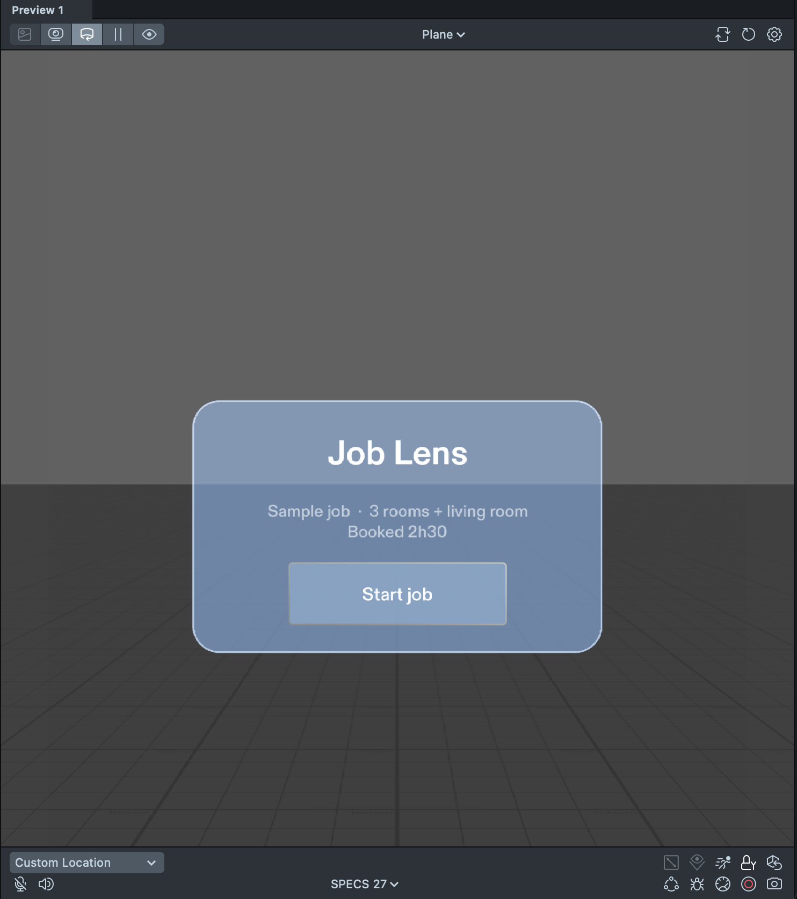
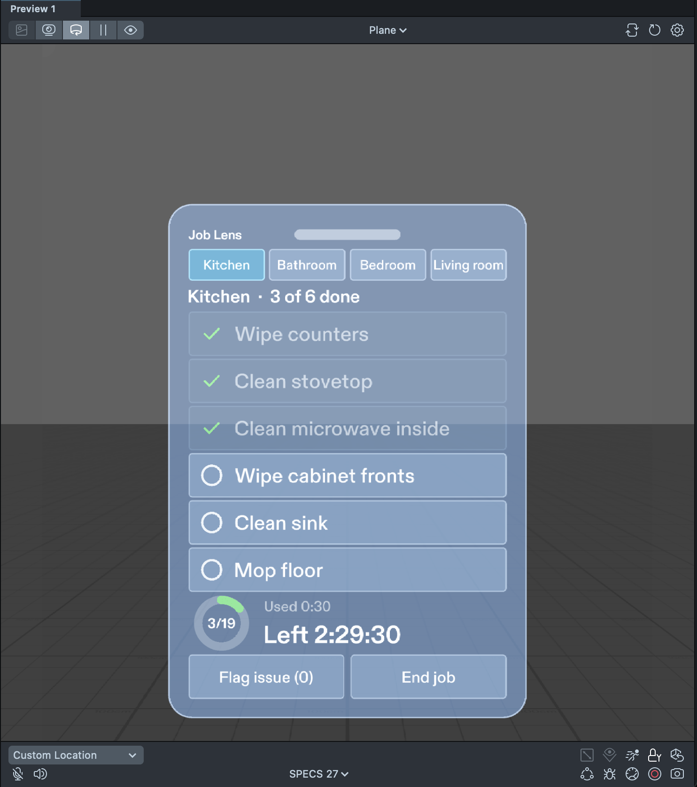
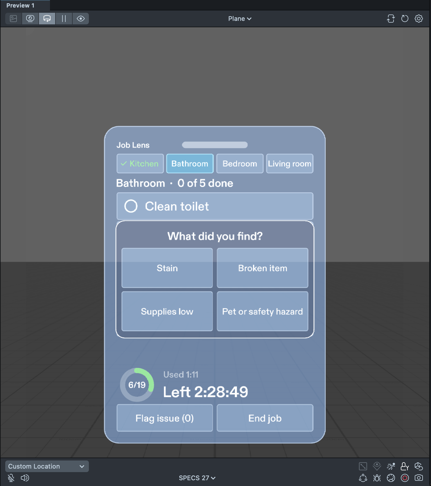
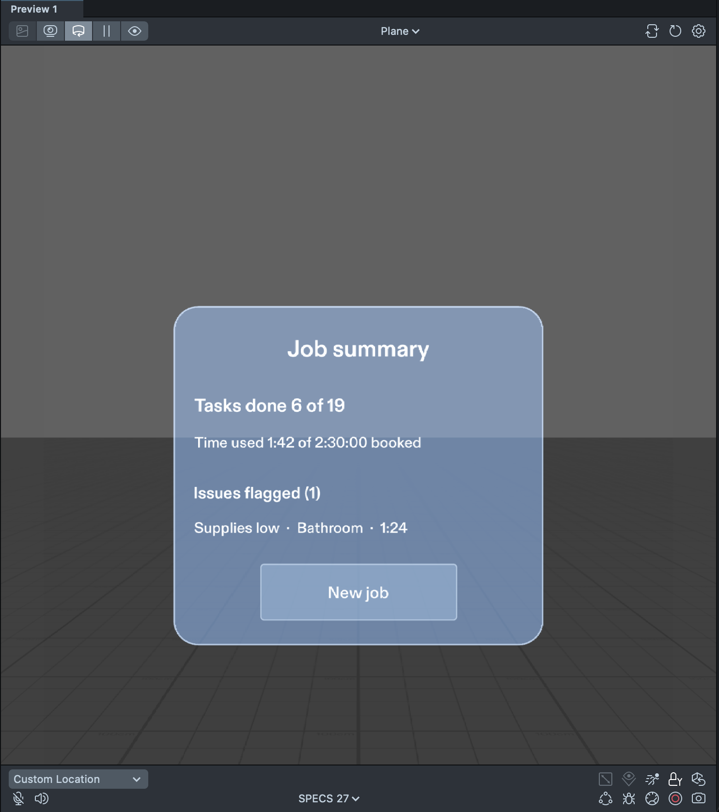

# Job Lens

A hands-free, room-by-room job checklist for home-service crews, built as a Lens for **Snap Spectacles (SPECS)**.
Entry for the Devpost hackathon **Learn AR with SPECS**.

During a clean your hands are gloved, wet, or holding a spray bottle and a cloth, so checking a list or the time on a phone means stopping, peeling off a glove and touching a phone with dirty hands. Job Lens parks one panel in the room beside the work: a glance and a pinch checks a task off, and the checklist, the job timer and the issue log stay there for the whole job.

  
  
  
  

*Screenshots from the Lens Studio preview.*

## Features

- **Room tabs** (Kitchen, Bathroom, Bedroom, Living room): pinch a tab to switch rooms; a finished room's tab is marked done and the panel moves on to the next unfinished room.
- **Check / uncheck tasks**: pinch a task row to tick it, pinch again to untick it. The room title shows the done count ("Kitchen · 3 of 6 done").
- **Progress ring** for the whole job (19 tasks in the sample job), with the done count in the middle.
- **Job timer**: time used and time left against the booked time (2 h 30 in the sample job). Time left turns a warmer colour under 15 minutes, and past zero it shows how far over the booked time the job is (overtime). No pop-ups or alarms.
- **Flag issue**: four big presets (Stain, Broken item, Supplies low, Pet or safety hazard). Each flag is logged with its room and time, a short confirmation fades out, and the button shows the running count ("Flag issue (1)").
- **End-of-job summary**: tasks done out of total, time used against the booked time, and every flagged issue with room and time; **New job** resets everything.
- **Drag handle**: pinch and drag the bar at the top to park the panel next to whatever you are cleaning; it stays where you leave it.
- **Off-screen arrow**: when the panel is out of view, a small arrow at the edge of the view points toward where it is parked.

## Open and run

1. Install **Lens Studio 5.22 or newer** (the project was built on **5.24.1**).
2. Clone this repository and open `job-lens-specs.esproj` in Lens Studio. The project target is **Spectacles (SPECS)**.
3. Press **Preview** (Interactive Preview: WASD to move, Q/E down/up, right-drag to look around; a click acts as a pinch). Pinch **Start job** to begin.

Lens Studio may ask you to allow the LEAF and Icon Atlas editor plugins on first open; allow them so the project compiles.

Status: tested in the Lens Studio preview only. It has not yet been run on a Spectacles device.

## Project layout

| Path | What it is |
| --- | --- |
| `Assets/Scripts/JobLensData.ts` | The sample job: 4 rooms, 19 tasks, 2:30:00 booked, 4 flag presets |
| `Assets/Scripts/JobLensState.ts` | Job state: checklist, room completion, issue log, real-time clock, overtime |
| `Assets/Scripts/JobLensPanel.ts` | The single movable panel: start card, checklist, flag menu and summary (UI built at runtime) |
| `Assets/Scripts/JobLensHintArrow.ts` | Edge arrow that points at the panel when it is out of view |
| `Assets/Scripts/Leaf/` | LEAF test scenarios |
| `Assets/Scene.scene` | The Lens scene |
| `devpost/design-brief.md` | The design brief written with the Devpost Learn skill pack |
| `skills-lock.json` | Lock entry for the `plan-lens` skill from [challengepost/learn-specs](https://github.com/challengepost/learn-specs) |

## How it was made

- **Planned** with the Devpost Learn skill pack for SPECS (`plan-lens` skill from [challengepost/learn-specs](https://github.com/challengepost/learn-specs)), which produced [`devpost/design-brief.md`](devpost/design-brief.md).
- **Built** by a coding agent through the **CLAD** plugin, with **Lens Studio** and the **Lens Studio MCP**.
- **Tested** with **LEAF** in the Lens Studio 5.24.1 preview. All 8 scenarios pass together in one LEAF "run all" from a fresh preview (each scenario resets the state it depends on, including the panel position):

| # | Scenario | Result |
| --- | --- | --- |
| 1 | Start job shows the Kitchen list (0 of 6) and the timer (0:00 used / 2:30:00 left) | passed |
| 2 | Pinching a task row checks it (count and ring update); pinching again unchecks it | passed |
| 3 | Finishing a room marks its tab done and moves on to the next room; tabs switch rooms | passed |
| 4 | Flag issue → Supplies low logs room and time, the confirmation fades, the button reads "Flag issue (1)" | passed |
| 5 | End job shows the summary; New job resets | passed |
| 6 | Timer turns warm under 15 minutes left and shows overtime past zero | passed |
| 7 | Pinch-dragging the handle moves the panel, and it stays put | passed |
| 8 | Reach test: an IK avatar can physically reach Start job and a task row | passed |

Not covered by a test: the off-screen arrow (checked by eye in the preview) and how the panel feels at a real counter, which needs real glasses.

## Pre-existing code and assets

This project was created new during the hackathon. It uses these pre-existing, third-party components, included unchanged under `Packages/` and `Plugins/`:

- **Lens Studio "Specs Base Template"** (Lens Studio 5.24.1), the starting project and render setup (`Assets/Render/`).
- **Spectacles Interaction Kit** 2.0.0 (`Packages/SpectaclesInteractionKit.lspkg`), hand interaction, pinch and drag.
- **Spectacles UI Kit** (`Packages/SpectaclesUIKit.lspkg`), frame, buttons, layout and rounded-rectangle visuals.
- **LEAF** 2.0.2 (`Packages/Leaf.lspkg`), the Lens test framework, with its dependency **Bitmoji 3D** 10.0.1 (`Packages/Bitmoji 3D.lsc`).
- **Motion** (`Packages/Motion.lspkg`), a tween package installed alongside the UI Kit.
- **Icons** with the **Icon Atlas** editor plugin (`Packages/Icons.lspkg`, `Plugins/.../IconAtlas/`); the icons in `Assets/Icons/` come from it.
- The **plan-lens** skill from the Devpost Learn skill pack ([challengepost/learn-specs](https://github.com/challengepost/learn-specs), MIT), used for planning; only its lock entry is kept here.

These components remain under their own licenses. The MIT license below covers the Job Lens code and assets written for this project (`Assets/Scripts/`, the scene, `devpost/`, `docs/`).

## Credits

Built by **Landon King** with **King AI**, an autonomous AI agent that can do anything a person can do on a computer, for **KING HOLDINGS VENTURES LLC**.

## License

[MIT](LICENSE) © 2026 KING HOLDINGS VENTURES LLC
